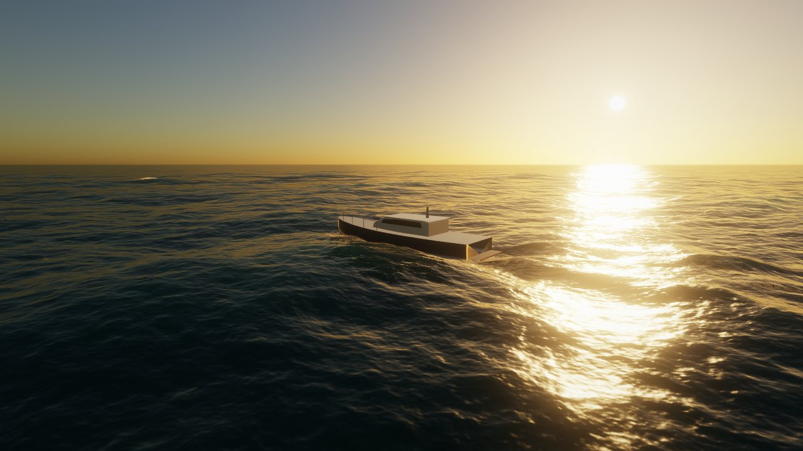
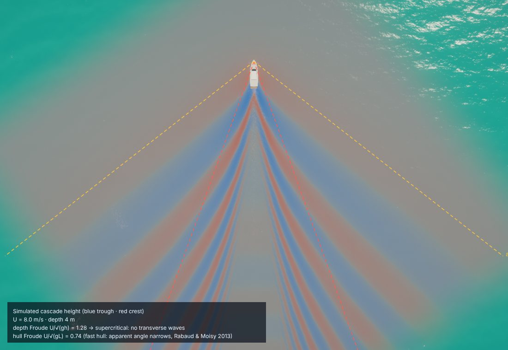
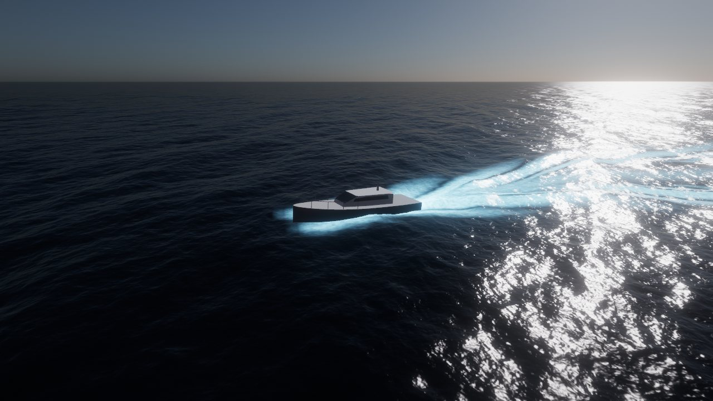
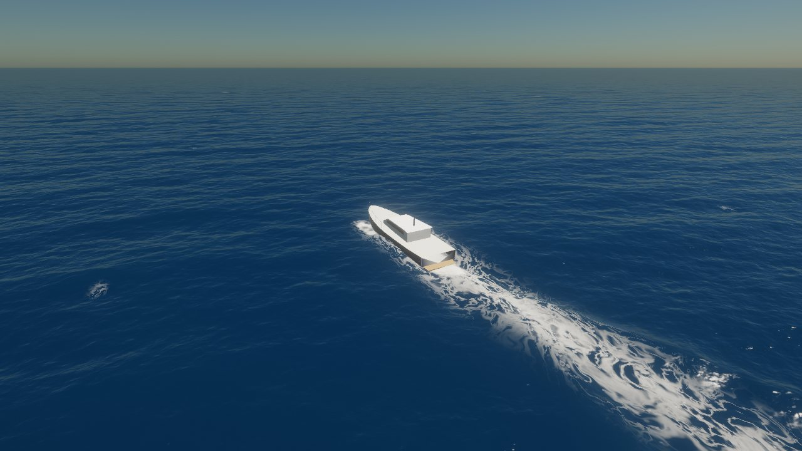
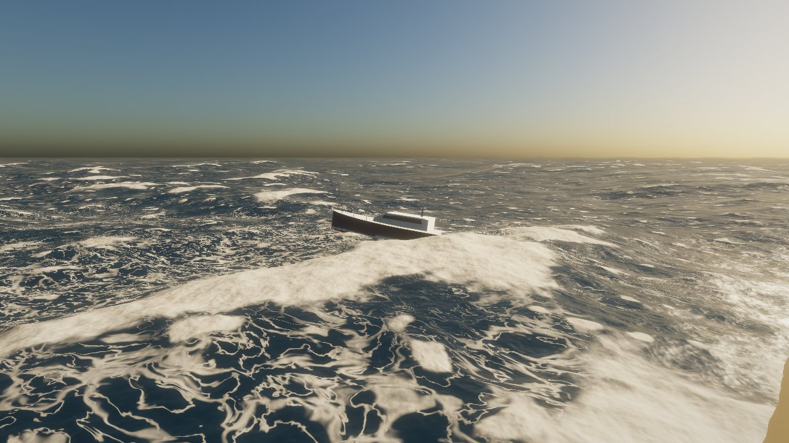
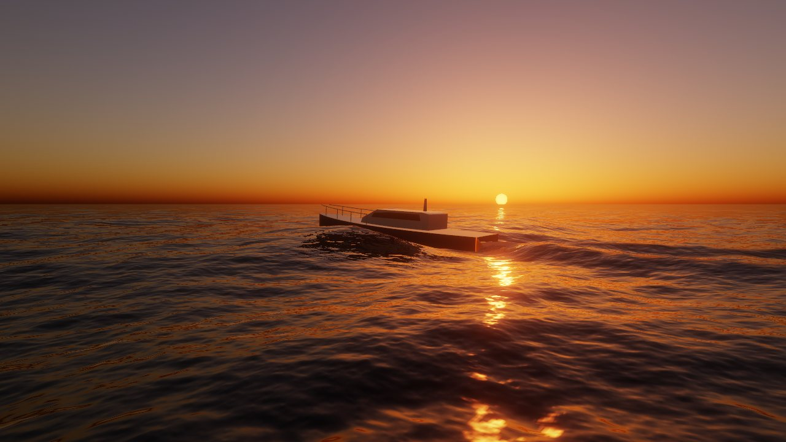

# html-3D-renderer

Two self-contained browser pages. Neither has a build step or any dependencies; open either file in a browser.

## `index.html` — 3D Wireframe Renderer

A Canvas 2D gallery of animated shapes: a tesseract, a DNA helix, an icosahedron, a Lorenz attractor and a torus knot. It also has a simple shaded ocean scene built from Gerstner waves.

## `ocean.html` — Spectral Ocean (WebGL2)

| | |
|---|---|
|  |  |
|  |  |
|  |  |

A real-time ocean built from published graphics and oceanography research. It adds a dynamic wave solver for boat wakes and splashes.

| Part | Technique | Source |
|---|---|---|
| Wave synthesis | 3 FFT cascades (400 m / 61 m / 11 m), 256² each, choppy displacement | Tessendorf, *Simulating Ocean Water*, SIGGRAPH 2001 course |
| Sea-state spectrum | JONSWAP + TMA (depth) + Donelan–Banner spreading + swell | Horvath, *Empirical Directional Wave Spectra for Computer Graphics*, DigiPro 2015 |
| Distant-wave shading | slope-moment mipmaps → anisotropic Gaussian BRDF; unresolved slopes from Cox–Munk | Bruneton, Neyret & Holzschuch, *Real-time Realistic Ocean Lighting using Seamless Transitions from Geometry to BRDF*, EG 2010; Cox & Munk 1954 |
| Whitecaps | Jacobian folding foam with decay | Dupuy & Bruneton, SIGGRAPH Asia 2012 tech brief |
| Foam calibration | threshold chosen analytically so coverage follows the measured whitecap law W = 3.84·10⁻⁶ U^3.41 | Monahan & O'Muircheartaigh 1980 |
| Sky | single-scattering Rayleigh + Mie + ozone, LUT reused for reflections and fog | Nishita et al., SIGGRAPH 1993; Bruneton 2017 |
| Bloom | 13-tap downsample with Karis average, tent upsample | Jimenez, SIGGRAPH 2014 course |
| Mesh | projected grid | Johanson 2004 |

### What's new: the dynamic spectral cascade

FFT oceans can only synthesize waves, so they can't respond to objects. Interactive wave solvers can respond, but they run in a separate pipeline with their own approximate dispersion, shading and foam. Here a **fourth FFT cascade is simulated rather than synthesized**:

- A 256 m window that follows the boat holds the linearised free-surface state (height *h*, potential *φ*).
- Each frame, the state goes to Fourier space. There every mode is a harmonic oscillator, advanced *exactly* by a rotation of ω(k)·Δt with ω² = g·k·tanh(k·h). This is the same finite-depth dispersion the wind spectrum uses, so the method is unconditionally stable and has no numerical dispersion.
- Sources (hull pressure, stones dropped by clicking) are added in real space. An absorbing sponge prevents wrap-around, and moving the window is an exact texel shift.
- The output has the same format as the wind cascades: displacement, slope moments and Jacobian. So wakes are filtered by the same BRDF at distance and foam through the same calibrated whitecap model.

None of the physics below is scripted. It comes out of the solver:

- a Kelvin wedge just inside 19.47° in deep water, which narrows at high hull Froude numbers as Rabaud & Moisy (2013) found;
- a widening, transverse-free wake once U/√(gh) > 1 in shallow water (Havelock 1908);
- dispersive ring trains from a dropped stone.

One practical finding: when the state goes through an FFT and back every frame, GPU `sin`/`cos` errors on the twiddle angles add up into faint ghost copies of the waves at N/4 offsets. A double-precision twiddle table, computed on the CPU, removes them.

Turn on **Wake physics view** in the panel to check this yourself. A top-down camera shows the simulated cascade's height in false colour, with the theoretical Kelvin and asin(1/Fr) lines and the live depth and hull Froude numbers drawn over it.

### Night

The moon drives the same scattering model as the sun, and its sky pass is added into the sky lookup texture. Its glints go through the same filtered BRDF, and the tone mapper applies a scotopic Purkinje shift (after Kirk & O'Brien, SIGGRAPH 2011). In the *Moonlit plankton* preset, bioluminescent plankton glow wherever the dynamic cascade churns the water: stern wash, bow spray, steep wake slopes and stone ripples.

### Floating bodies

The boat's heave, pitch and roll come from **asynchronous GPU probes** (read back through a pixel buffer and a fence). Choppy waves move water sideways, so each probe inverts the horizontal displacement by fixed-point iteration, x₀ ← x − D(x₀). It samples the cascades at the mip level that matches the hull's size, so the hull averages out ripples smaller than itself. Damped springs give it inertia.

### Controls

- Drag to look or orbit, scroll to zoom.
- Click the water to drop a stone.
- WASD or the arrow keys move the camera. With the chase camera on, they steer and throttle the boat.
- Q/E change camera height, and H hides the UI.
- The *How it works* panel explains each technique on the page itself.
